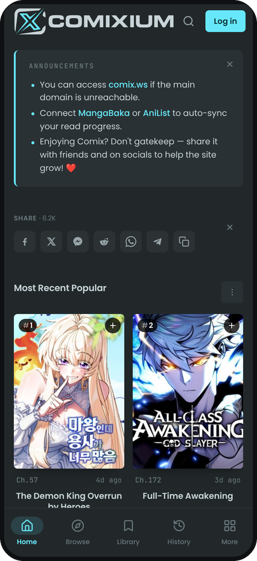
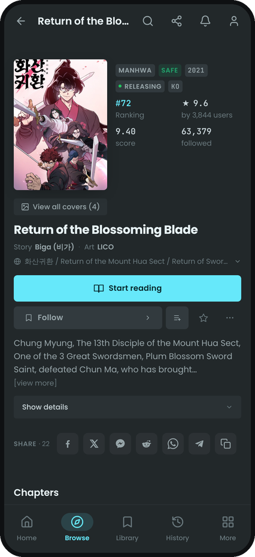
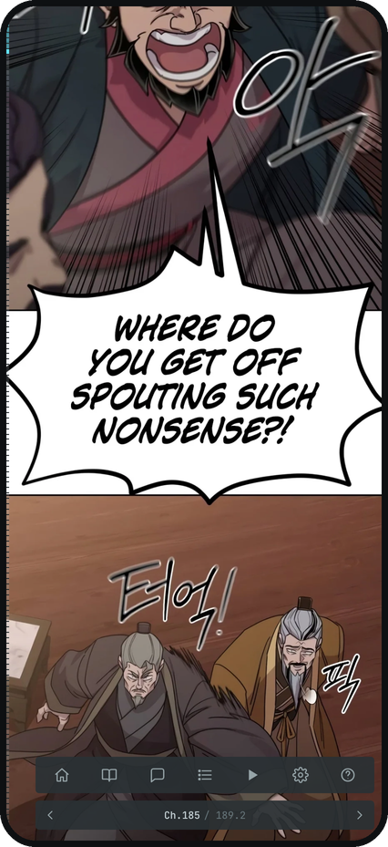
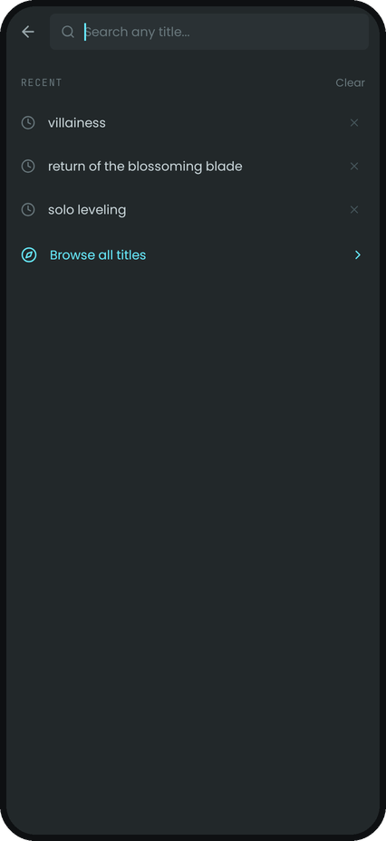
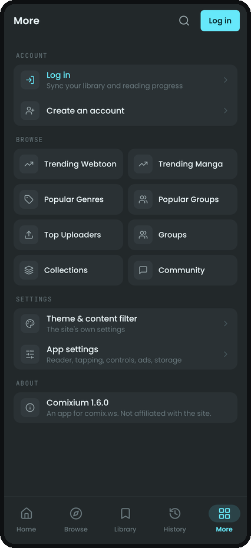

  <picture>
    <source media="(prefers-color-scheme: dark)" srcset="docs/images/logo-dark.svg">
    
  </picture>

  <b>comix as a real Android app.</b> 
  The site you know and love, with native navigation, a better reader and no ads.

  

  
  
  

| Home | Series | Reader | Search | More |
| :---: | :---: | :---: | :---: | :---: |
|  |  |  |  |  |

## Features

**Feels like an app, not a website**

- Bottom tabs for Home, Browse, Library, History and More, each remembering where you were
- Native top bar, search with recent searches, and Back that goes where you expect (popups close first)
- Pull to refresh, proper offline and site-down screens
- Switches to comix.to automatically when comix.ws is down

**Reads better**

- Full screen chapters that keep the screen awake
- Double tap to show the controls, tap the edges to turn pages or scroll, pinch to zoom
- Tapping is fully adjustable: zones on the sides or top and bottom, three sizes, inverted, or off
- Volume keys turn pages, normal or inverted
- Reader controls can be moved and resized: rail, bar or minimal; top or bottom; left, center or right
- Every reader option in one settings sheet, opened from the gear while reading

**No ads**

- Removes the popunder that opens on the first tap, and the promo banners
- Blocks known ad and tracker hosts
- Other sites only open when a link to them is actually tapped

**Looks like comix**

- Every page is drawn by comix itself, so it looks and works like the site
- App colours follow the theme picked in the site's settings
- Mobile optimizations tidy up the spots where the site still acts like a desktop page

**Handy extras**

- Share any series; long-press an image to save or share it
- Downloads and library backups work
- comix links from other apps open in Comixium
- Hide the home page announcements and share bar

## Install

1. Download `comixium-<version>.apk` from the [latest release](https://github.com/notsonata/comixium/releases/latest).
2. Open it on your phone and allow installs from your browser or files app when Android asks.
3. Log in with your comix email and password.

**Updating:** install the newer APK over the old one. Login and settings are kept.

Requires Android 8.0 or newer.

## FAQ

<b>Is this an official comix app?</b>

 
No. Comixium is an unofficial app. All content comes from comix.ws, shown by the site itself.

<b>Why can't I sign in with Google?</b>

 
Google blocks its sign-in inside apps that display web pages, so the button is hidden. Use your comix email and password instead.

<b>comix.ws is down. Does the app still work?</b>

 
Yes. It retries on comix.to automatically for the rest of the session. The two domains keep separate logins, so you may need to log in again there. The domain can also be switched by hand in More → Settings.

<b>Something looks off after a site update</b>

 
The app hooks into parts of the site, and a daily check flags when comix changes them, so fixes usually follow quickly. In the meantime, turning off <b>Mobile optimizations</b> in More → Settings shows the site's own layout.

<b>Where are the settings?</b>

 
While reading, the gear in the reader controls opens every reader option in one sheet: tapping, volume keys, zoom, full screen, controls layout and the site's own reader settings. The More tab has the same reader options plus home page blocks, ad blocking, mobile optimizations, domain and cache. The site's general settings (theme, content filter) open from More → Theme & content filter, as a sheet you swipe down to close.

<b>Does the app collect any data?</b>

 
No. There is no analytics or tracking of its own. It only talks to comix.ws / comix.to and the image servers they use, plus any site opened from a tapped link, and it blocks known trackers.

## What's new

See [Releases](https://github.com/notsonata/comixium/releases) or [CHANGELOG.md](CHANGELOG.md).

## Building from source

See [docs/DEVELOPMENT.md](docs/DEVELOPMENT.md) for how the app works, building, tests, the daily site check and the release process.

## Credits

- Content: [comix.ws](https://comix.ws). Comixium is not affiliated with comix.
- Fonts: Poppins and JetBrains Mono, SIL Open Font License
- Icons: drawn from [Lucide](https://lucide.dev), ISC License
- Ad and tracker list: [StevenBlack/hosts](https://github.com/StevenBlack/hosts), MIT License

Licence texts are in [`third_party/`](third_party).
